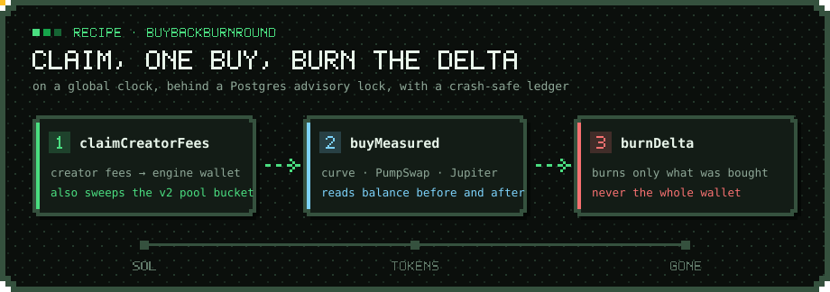
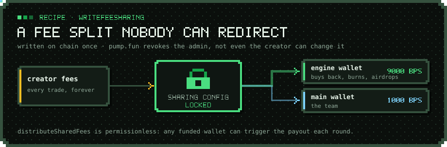

<p align="center">
  
</p>

<p align="center">
  <b>Claims · buys · burns · airdrops · holder snapshots · launches · fee sharing</b><br>
  The pieces every one of our launches reuses, pulled out of the engines that run them in production.<br>
  Every fix made in a live engine comes back here.
</p>

<p align="center">
  <a href="#quick-start">Quick start</a> ·
  <a href="#examples">Examples</a> ·
  <a href="#cli">CLI</a> ·
  <a href="#modules">Modules</a> ·
  <a href="#gotchas-baked-in-do-not-undo-them">Gotchas</a>
</p>

---

## Why

Every tek we ship (BLAST, ETF, TUNGBANK, PUMPDRAW, THE KITCHEN, LABRAT, SLINGFOLIO…) needs the same dozen
operations on Solana and pump.fun. Each project used to carry its own copy, so a bug fixed in one stayed broken
in the rest. pumpkit is those operations as plain functions, with every production incident baked in:

- **Plain ESM JavaScript, no build step.** Read it, fork it, vendor it.
- **`ctx` first, plain values after.** Nothing reads `process.env` except `createContext()` defaults.
- **`bigint` raw units at the boundary.** Floats only in logs.
- **No "everything in the wallet" helpers.** You burn, sell and send what you measured, never the balance.
- **It keeps improving.** A fix made in a live engine is ported here first, then to every copy.

<p align="center"></p>

## Quick start

```bash
npm i github:openpumptrade/pumpkit        # as a dependency
# or vendor it: cp -R src/ <project>/vendor/pumpkit/src — it is meant to be read and forked
cp .env.example .env                      # RPC_URL, PRIVATE_KEY (CLI only)
npm run smoke                             # read-only checks against mainnet, no keys
```

```js
import { createContext, keypairFromSecret, claimCreatorFees, buyMeasured, burnDelta } from "pumpkit";

const ctx = createContext({ rpcUrl: process.env.RPC_URL, slippagePct: 5 });
const wallet = keypairFromSecret(process.env.PRIVATE_KEY);

const { claimedRaw } = await claimCreatorFees(ctx, { wallet, mint });                  // creator fees → wallet
const buy = await buyMeasured(ctx, { wallet, mint, lamports: claimedRaw });             // curve / PumpSwap / Jupiter
await burnDelta(ctx, { wallet, mint, balanceBeforeRaw: buy.balanceBeforeRaw });         // burn ONLY what the buy brought in
```

Requires Node ≥ 20.

## Examples

### Buy any coin, wherever it trades

<p align="center"></p>

```js
import { buyMeasured, sellAny } from "pumpkit";

const buy = await buyMeasured(ctx, { wallet, mint, lamports: 500_000_000n });   // 0.5 SOL
// { sig, venue: "curve" | "pumpswap" | "jupiter", spentLamports, boughtRaw, balanceBeforeRaw }

await sellAny(ctx, { wallet, mint, tokenAmountRaw: buy.boughtRaw });             // exactly what the buy brought in
```

### Buyback and burn (BLAST)

<p align="center"></p>

```js
import { createContext, keypairFromSecret, createScheduler, buybackBurnRound } from "pumpkit";

const ctx = createContext({ rpcUrl: process.env.RPC_URL });
const wallet = keypairFromSecret(process.env.PRIVATE_KEY);
const state = { burnOwedRaw: 0n, carrySol: 0 };          // persist these in your DB between rounds

const scheduler = createScheduler({
  intervalSec: 180,                                      // one global clock: every visitor sees the same countdown
  run: async (cycle) => {
    const r = await buybackBurnRound(ctx, {
      wallet, mint: process.env.MINT, burnOwedRaw: state.burnOwedRaw, carrySol: state.carrySol,
      dryRun: process.env.DRY_RUN !== "false",
      ledger: {                                          // crash-safe: what was bought is owed until it is burned
        afterBuy: ({ boughtRaw }) => { state.burnOwedRaw += boughtRaw; },
        afterBurn: ({ burnedRaw }) => { state.burnOwedRaw -= burnedRaw; },
      },
    });
    console.log(`#${cycle}`, r.note);
  },
});
scheduler.start();
```

Runnable version: [`examples/buyback-burn-engine.js`](examples/buyback-burn-engine.js).

### Claim → buy a reward coin → airdrop to holders (TUNGBANK)

<p align="center"></p>

One call does the whole round:

```js
import { claimBuyAirdropRound, nextSkipStreaks } from "pumpkit";

let skipStreaks = new Map();                             // persist per (wallet, rewardMint)

const r = await claimBuyAirdropRound(ctx, {
  wallet, mint, rewardMint,                              // rewardMint unset → pays SOL directly
  snapshotOpts: { maxHolders: 4000 },
  airdropOpts: { skipStreaks, ataRentThresholdSol: 0.002, ataSkipGraceCycles: 10 },
  ledger: { afterAirdrop: (d) => { skipStreaks = nextSkipStreaks(skipStreaks, d.outcomes); } },
});
console.log(r.note, r.txs);
```

Or compose the pieces yourself:

```js
import { snapshotHolders, proRata, airdropTokens } from "pumpkit";

const snap = await snapshotHolders(ctx, { mint, exclude: [wallet.publicKey.toBase58()], minRaw: 1_000_000n });
const shares = proRata(snap.holders, amountRaw);         // [{ wallet, raw, amountRaw, share }], zero shares dropped
const drop = await airdropTokens(ctx, { wallet, mint: rewardMint, amountRaw, holders: snap.holders, eligibleRaw: snap.eligibleRaw });
// drop.outcomes: one row per wallet (paid / skipped / failed) — pumpkit never writes to a DB, you persist it
```

Full version: [`examples/claim-buy-airdrop.js`](examples/claim-buy-airdrop.js).

### Trustless launch (PUMPDRAW)

<p align="center"></p>

The server never holds a key. It builds unsigned bytes, the browser checks them, the user signs, the server relays.

```js
// server: unsigned bytes only
const built = await buildLaunchTxs(ctx, { user, mint, name, symbol, uri, devBuyLamports, feeLamports, treasury });

// browser, BEFORE the wallet popup (pure web3.js, import from "pumpkit/pumpfun/verify")
const checks = await verifyLaunch(connection, txs, lookupTable, { wallet: user, mint, treasury, feeLamports, name, symbol, devBuyLamports, slippagePct });
if (!allOk(checks)) throw new Error("launch bytes do not match what you asked for");

// server again: forward the signed bytes untouched, list the coin only when the fee is proven on chain
const { sig } = await relaySigned(ctx, signedTx, lastValidBlockHeight);
const tx = await fetchTransaction(ctx, sig);
const paid = tx && balanceDelta(tx, treasury) >= feeLamports;
```

Full version: [`examples/trustless-launch-server.js`](examples/trustless-launch-server.js).

### Immutable fee split (ETF)

<p align="center"></p>

```js
await createCoin(ctx, { wallet: engine, name, symbol, uri });                   // engine wallet is the creator
await writeFeeSharing(ctx, { wallet: engine, mint, shareholders: [
  { address: engine.publicKey.toBase58(), shareBps: 9000 },
  { address: mainWallet, shareBps: 1000 },
] });                                                                          // pump.fun revokes the admin: locked forever
await distributeSharedFees(ctx, { mint, wallet: anyFundedWallet });              // permissionless, every round
```

## CLI

<p align="center"></p>

```bash
node bin/pumpkit.js info <mint>                        # program, decimals, creator, tax, market, sharing config
node bin/pumpkit.js holders <mint> --top 20            # snapshot (needs an RPC that allows getProgramAccounts)
node bin/pumpkit.js fees                               # unclaimed creator fees of PRIVATE_KEY's wallet
node bin/pumpkit.js claim --yes
node bin/pumpkit.js buy <mint> 0.1 --yes               # routes curve / PumpSwap / Jupiter
node bin/pumpkit.js burn <mint> 1000000 --yes          # exact amount, UI units
node bin/pumpkit.js airdrop <holdersOfMint> --reward <mint> --amount 5000000 --yes
node bin/pumpkit.js airdrop <holdersOfMint> --sol 1.5 --yes
node bin/pumpkit.js fee-split <mint> <engine>:9000 <main>:1000 --yes   # on-chain, locked forever
node bin/pumpkit.js simulate-create "name" "TICKER13CHARS"             # free, no wallet
```

Run without arguments for the full list. Everything that moves funds needs `--yes`.

## Modules

| module | what it holds |
|---|---|
| `context` | `createContext({rpcUrl, snapshotRpcUrl, priorityMicroLamports, slippagePct})`, SDK singletons (CJS-loaded — the pump SDKs' ESM builds break on Node), constants, `chunk/sleep/pk/lamportsOf` |
| `tx` | `sendTx` (v0 + priority fee + simulate + confirm, retries BlockhashNotFound), `simulate` (free, no keys), `compileUnsigned` (for user wallets), `relaySigned` (forward someone else's signed bytes), `fetchTransaction`, `balanceDelta`, `withRetry` |
| `wallet` | `keypairFromSecret` (bs58 or JSON), `newWallet`, `getSolBalance`, `sendSol`, `sweepSol`, `encryptSecret/decryptSecret` (AES-256-GCM), `assertMasterKey` |
| `token` | `mintProgramId` (Token-2022 vs SPL — never assume), `ataOf`, `tokenBalanceRaw`, `tokenBalanceSettled`, `tokenAccounts` (all accounts, not just the ATA), `totalSupply`, `readMetadata`, `mintInfo`, `auditMint` |
| `transfer` | `transferTokens` (exact), `transferAllTokens`, `batchTransferTokens`, `transferInstructions` (hook-aware), `closeEmptyAta`, `existingAtas` |
| `burn` | `burnTokens` (exact), `burnDelta` — there is **no burnAll** (see gotchas) |
| `jupiter` | `jupiterQuote`, `jupiterSwap`, `swapSolFor`, `swapForSol`, `hasRoute`, `roundTripPct`, `getUsdPrice`, `getSolUsd`, `jupiterTokenMeta` — on `lite-api.jup.ag` (v6 is dead) |
| `swap` | `buyAny` / `sellAny` (curve → PumpSwap → Jupiter routing), `buyMeasured` (reads balances before/after so the caller knows exactly what was spent and bought) |
| `holders` | `snapshotHolders` (getProgramAccounts, balances summed per owner, system accounts excluded, real wallets only), `topHolders` (no gPA), `filterWallets`, `proRata`, `heldOrGrew`, `systemExclusions` |
| `airdrop` | `airdropTokens` (ATA-rent policy, hook-aware, concurrent batches, per-wallet outcomes), `airdropSol` (rent-exempt skip), `nextSkipStreaks` |
| `engine` | `createScheduler` (global clock), `advisoryLock` (Postgres, keep-alive), `collectFees`, `buybackBurnRound`, `claimBuyAirdropRound` |
| `pumpfun/curve` | `pumpGlobals`, `taxConfig`, `SOL_QUOTE`, `resolveQuote`, `fetchQuoteCatalog`, `loadCurve`, `isGraduated`, `estimateCurveBuy`, `curveBuy/curveSell`, `buildCurveBuy/buildCurveSell` (unsigned) |
| `pumpfun/pumpswap` | `pumpswapBuy/pumpswapSell`, `buildPumpswapBuy/Sell`, `poolOf` |
| `pumpfun/fees` | `creatorVaultBalances`, `claimInstructions`, `claimCreatorFees` (pass `mint` to also sweep a v2 pool's bucket), `sweepCreatorFeeIx`, `poolCreatorFeeBucket`; fee sharing: `feeSharingInstructions`, `writeFeeSharing`, `readSharingConfig`, `sharedFeesWaiting`, `distributeSharedFees` (permissionless) |
| `pumpfun/create` | `uploadIpfs`, `buildCreate` (SOL or custom pair, tax), `simulateCreate`, `createCoin` (custodial + dev buy → user), `buildLaunchTxs` (trustless, unsigned), `staticLaunchAccounts` (ALT contents) |
| `pumpfun/market` | `fetchCoinInfo` (DexScreener fallback — pump.fun's `/coins/<mint>` is gone), `fetchMarkets`, `searchTokens`, `fetchCandles`, `fetchTrades`, `fetchTopHoldersList` |
| `pumpfun/verify` | `verifyLaunch` — browser-side check of the launch bytes BEFORE the wallet signs (pure web3.js) |

## Gotchas baked in (do not undo them)

Each one cost real money or a production incident.

1. **pump.fun mints are Token-2022** (older ones classic SPL). `getAssociatedTokenAddressSync` defaults to the classic program → wrong ATA → "buy confirmed, no tokens received". Always `mintProgramId()`.
2. **Never burn / sell / transfer "everything the wallet holds".** The engine wallet is usually the creator wallet with the user's dev bag in it. Round #1 of BULLS VS BEARS burned ~1 ETH of the user's tokens that way. Use `buyMeasured` + `burnDelta` / `burnOwedRaw`.
3. **Jupiter v6 is dead**, `lite-api.jup.ag/swap/v1` is the drop-in. Price on `/price/v3`.
4. **pump.fun `/coins/<mint>` 404s** since Sep 2026 → `fetchCoinInfo` falls back to DexScreener.
5. **The pump SDKs' ESM builds break on Node** (bad anchor imports) — `context.js` loads the CJS builds via `createRequire`.
6. **getProgramAccounts** is refused by publicnode and rate-limited by api.mainnet-beta → separate `snapshotRpcUrl` + backoff. Helius/Chainstack keys run out of quota and crash-loop the engine at boot; keep a fallback.
   publicnode also refuses "indexed" calls (`getTokenSupply`, `getTokenLargestAccounts` → we read the mint account / use the snapshot RPC) and, since Oct 2026, **caps `getMultipleAccountsInfo` at 10 keys** ("403 Request blocked") → `getMultipleAccounts(ctx, keys)` shrinks the batch by itself. Never call `connection.getMultipleAccountsInfo` directly.
7. **Airdrop ATA rent**: creating a token account for a holder costs ~0.002 SOL. Policy: pay it when the drop is worth it or after N skipped rounds, once per wallet ever; skip holders who closed an account the engine paid for.
8. **Railway redeploys overlap** two containers for a few seconds and kill the old one mid-tx → `advisoryLock` on a reserved connection with keep-alive, crash-safe ledger hooks (`ledger.afterBuy` before `afterBurn`), deploy only when `scheduler.busy()` is false.
9. **Ticker max is 13 bytes** on chain (UI says 10); `simulateCreate` is the free way to test any limit.
10. **Secrets**: `assertMasterKey` at boot. A `grep MASTER_KEY .env` once matched a comment line and shipped a broken key to production — use `grep -E '^MASTER_KEY='`.
11. **Trustless launches**: the browser owns the mint keypair, the server builds unsigned bytes, `verifyLaunch` runs before signing, `relaySigned` cannot alter anything, and the listing waits for `balanceDelta(tx, treasury) ≥ fee`.

12. **v2 PumpSwap pools park creator fees inside the pool** until someone calls `sweep_creator_fee`. 6.3 SOL sat unclaimed on $SLINGFOLIO. `claimCreatorFees({mint})` and `distributeSharedFees` sweep first; changing fee shares on a graduated coin needs the sweep + claim in the SAME transaction (6081 CreatorFeesNotSwept).
13. **A slow public RPC reports "block height exceeded" for a tx that landed.** `sendTx` / `jupiterSwap` check the signature status before throwing — retrying blindly would do the buy twice.
14. **Some public RPCs refuse `getTokenAccountBalance`** → `tokenBalanceRaw` falls back to reading the token account bytes.

## Development

```bash
npm run check     # every module imports
npm run smoke     # read-only mainnet checks, no keys
npm run site      # preview the landing page in site/ (http://localhost:4173)
```

Anything that signs is tested by hand with `bin/pumpkit.js … --yes` on a throwaway wallet and tiny amounts.
Conventions for contributors and Claude Code sessions are in [`CLAUDE.md`](CLAUDE.md).

## Versions

`@pump-fun/pump-sdk` 2.0.0 · `@pump-fun/pump-swap-sdk` 1.20.0 · `@solana/web3.js` 1.99 · `@solana/spl-token` 0.4.15 — the combination every live engine of ours runs on.

<p align="center"><br><sub>pumpkit · <a href="LICENSE">MIT</a> · <a href="https://pumpkit-phi.vercel.app">pumpkit-phi.vercel.app</a></sub></p>
